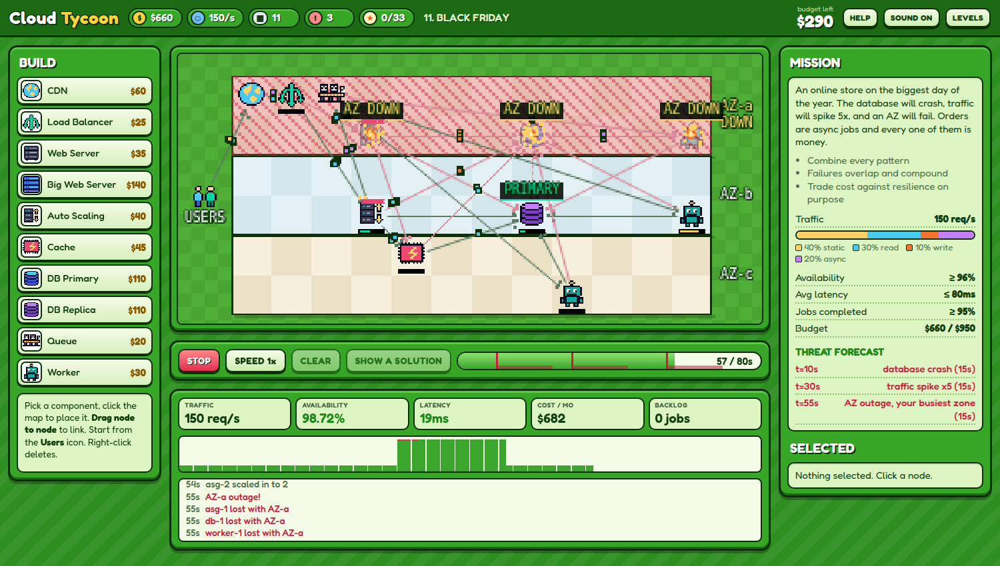

# Cloud Tycoon

A 2D pixel game for learning cloud architecture design. Build an architecture on a map of three stacked Availability Zones, hit RUN, and watch traffic flow while scheduled failures try to break it. Aimed at junior SRE, Cloud and DevOps engineers.



## Run it

Open `index.html` in a browser. No build step, no server, no dependencies.

```bash
xdg-open index.html
# or serve it and open http://localhost:8000
python3 -m http.server 8000
```

Progress and designs are saved in the browser's localStorage.

## How to play

1. **Pick a scenario.** Start with "Hello, Cloud". The Mission panel on the right shows the story, the traffic mix, the targets, the budget and the threat forecast.
2. **Build.** Pick a component on the left and click a tile to place it. The three bands on the map are Availability Zones, top to bottom.
3. **Link.** Drag from the Users icon to your first component, then from node to node, so requests have a path: for example Users, Load Balancer, Web Server, DB Primary.
4. **Watch the budget.** The "budget left" number in the top right updates as you build. Going over budget fails the run.
5. **Hit RUN.** Traffic flows as coloured packets: yellow static, blue read, orange write, purple async job. Threats fire at the times shown in the forecast.
6. **Read the map.** A label appears over any node in trouble: `CRASHED`, `AZ DOWN`, `OVERLOAD`, `DB DOWN`, `NO DB LINK`, `FAILOVER`. A red X means a request was dropped there. Click a node during the run for the breakdown.
7. **Read the post-mortem.** The result screen lists each target and explains what broke and how to fix it. Fix the design and run again.
8. **Stuck?** After one failed run, SHOW A SOLUTION loads one working design. There are other valid answers.

Meeting every target gives 2 stars. Doing it at 80% of budget or less gives 3.

## Controls

- **Place:** pick a component, click a tile.
- **Link:** drag from one node onto another. Start from the Users icon. Drag the same link again to remove it.
- **Move:** drag a node onto an empty tile.
- **Delete:** right-click a node, or select it and press Delete.

## Scenarios

| # | Scenario | Teaches |
|---|---|---|
| 1 | Empty Lot | VPC, public/private subnet, Internet Gateway, Security Group |
| 2 | One Server for Everything | Monolith on EC2, vertical scaling, SSH from My IP only |
| 3 | The Database Moves Out | RDS in a private subnet, SG that only accepts sg-web |
| 4 | Product Photos | S3 for assets, public-read bucket, IAM Role |
| 5 | One Building Goes Dark | Multi-AZ, load balancer, RDS standby |
| 6 | The 12.12 Sale | Auto Scaling in private subnets, NAT Gateway per AZ |
| 7 | Hello, Cloud | Request path basics |
| 8 | The 3 AM Crash | Redundancy, load balancer health checks, N+1 |
| 9 | Zone Down | Multi-AZ design, failure domains |
| 10 | Database Down | Replication, failover, RTO |
| 11 | Cache Me If You Can | Caching read-heavy load |
| 12 | Cache Stampede | Designing for a cold cache |
| 13 | Background Jobs | Message queues, workers, backlog |
| 14 | Flash Sale | Auto scaling, scaling lag, minimum capacity |
| 15 | Going Global | CDN and edge latency |
| 16 | Penny Pincher | Cost optimization, right-sizing |
| 17 | Black Friday | Everything at once |
| 18 | Sandbox | Free play with chaos buttons |

Scenarios 1 to 6 are an AWS networking course for vocational students: one continuing story where each level starts from the design of the previous one, ending in a three-tier app (VPC, EC2, RDS, S3). They add a best-practice audit to the score.

Each run is scored on availability, average latency, monthly cost and async job completion. Passing gives 2 stars. Spending 80% of budget or less gives 3. A failed run produces a post-mortem that names what broke and why.

## Layout

| File | Purpose |
|---|---|
| `js/components.js` | Component catalogue: capacity, cost, latency, link rules |
| `js/sim.js` | Traffic and chaos simulator, post-mortem advice. Pure logic, no DOM |
| `js/scenarios.js` | Scenario definitions and reference designs |
| `js/sprites.js` | Pixel sprites as text maps |
| `js/game.js` | Canvas rendering, editing, UI |
| `test/check.js` | Headless balance check |

## Test

```bash
node test/check.js
```

Runs every reference design through the simulator and asserts it passes, and that the naive single-server design fails. Run it after changing any number in `components.js` or `scenarios.js`.

`index.html?demo=<scenario id>` loads the reference design and runs it. Add `&fast=1` to jump straight to the result.

## Adding a scenario

Append an object to `SCENARIOS` in `js/scenarios.js`: traffic `rate` and `mix`, `budget`, `targets`, a list of `events` (`kill`, `az`, `spike`), the `allowed` components and a reference `solution`. Then run the test.

## Simplifications

The model is deliberately small. Costs are proportional, not real prices. Latency is an average, not a percentile. One database primary only. The simulation is deterministic, so the same design always gets the same result.
